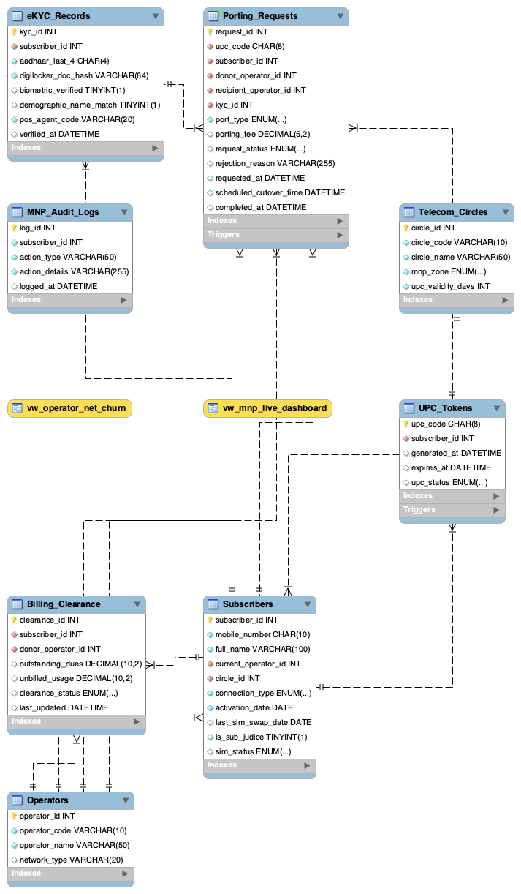

# MNP & eKYC Lifecycle Tracker

A MySQL database project that models the **Mobile Number Portability (MNP)** lifecycle in India, from UPC generation and eKYC verification to the atomic night-window SIM cutover. Eligibility rules follow TRAI and DoT regulations and are enforced inside the database itself using triggers, stored procedures and scheduled events.

## EER Diagram



## Features

- **3NF normalized schema** with 8 tables: `Telecom_Circles`, `Operators`, `Subscribers`, `eKYC_Records`, `Billing_Clearance`, `UPC_Tokens`, `Porting_Requests`, `MNP_Audit_Logs`
- **Pre-check gate trigger** (`trg_Before_UPC_Insert`) rejects UPC generation when:
  - the number is under a legal / sub-judice hold
  - the subscriber has less than 90 days on the current network
  - a SIM swap happened less than 7 days ago (DoT cooling-off)
  - a postpaid subscriber has unpaid dues
- **Dynamic UPC expiry**: 4 days by default, 30 days for J&K, Assam and North-East circles
- **eKYC validation trigger** (`trg_Before_PortRequest_Insert`) checks the UPC status and the biometric and demographic match, then auto-schedules the cutover (3 days intra-circle, 5 days inter-circle)
- **Atomic cutover** (`sp_ExecuteAtomicCutover`) runs as a single transaction with rollback on any error
- **24-hour withdrawal** (`sp_WithdrawPortRequest`) follows the TRAI cancellation window
- **Scheduled event** (`ev_AutoExpireUPCs`) marks expired UPCs every hour
- **Analytical views**: `vw_MNP_Live_Dashboard` and `vw_Operator_Net_Churn`
- **Audit log** records every state change for compliance

## Repository Structure

```
mnp-ekyc-lifecycle-tracker/
├── README.md
├── .gitignore
├── database/
│   └── mnp_ekyc_tracker.sql    # Schema, triggers, procedures, event, sample data, views, tests
└── docs/
    └── eer_diagram.png         # EER diagram exported from MySQL Workbench
```

## Getting Started

**Requirements:** MySQL 8.0+ (MySQL Workbench recommended). The account needs privileges to create databases, triggers and events, and to run `SET GLOBAL event_scheduler = ON`.

### Option 1: MySQL Workbench
1. Open `database/mnp_ekyc_tracker.sql` in Workbench.
2. Run the script (lightning bolt icon).

### Option 2: Command line
```bash
mysql -u root -p < database/mnp_ekyc_tracker.sql
```

> The script drops and recreates the `telecom_mnp_tracker` database each time it runs.

## Test Scenarios

Section 7 of the script ends with three inserts that are **meant to fail**, to prove the rules work. Each one raises error code `1644`:

| Test | Subscriber | Reason for rejection |
|------|-----------|----------------------|
| 1 | Vikram Singh | Unpaid postpaid dues (Rs. 849) |
| 2 | Neha Gupta | Fewer than 90 days on the network |
| 3 | Kabir Das | SIM swapped 2 days ago (DoT 7-day rule) |

These errors are expected. In Workbench, the script stops at the first one, so run them one at a time if you want to see all three.

## Sample Data Highlights

| Subscriber | Scenario | Result |
|-----------|----------|--------|
| Aarav Sharma | Valid eKYC, Vi to Jio | Cutover completed |
| Priya Verma | Valid postpaid, Airtel to Jio | Scheduled for cutover |
| Rohan Mehta | J&K circle (30-day UPC), name mismatch | Auto-rejected |

## Tech Stack

MySQL 8.0 · MySQL Workbench · SQL (triggers, stored procedures, events, views)
